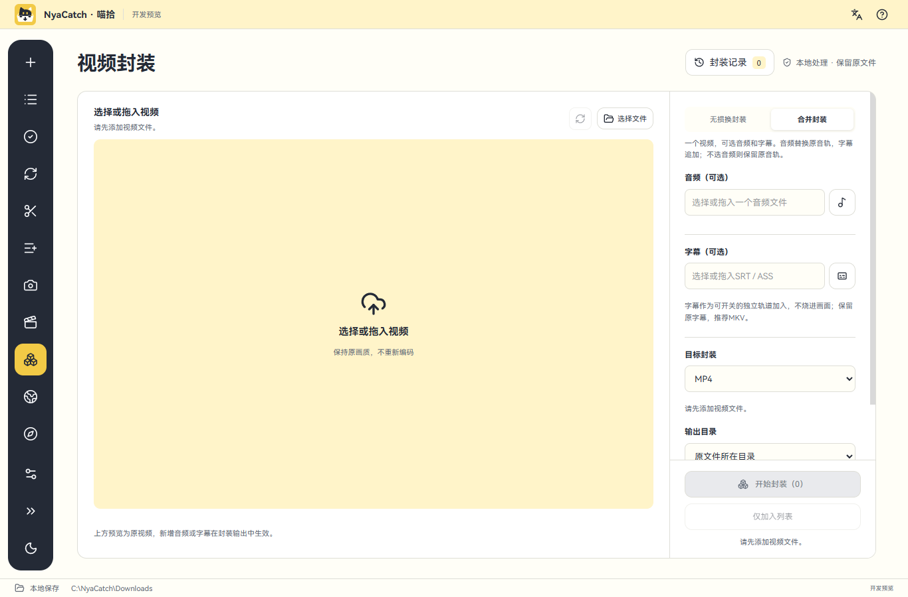
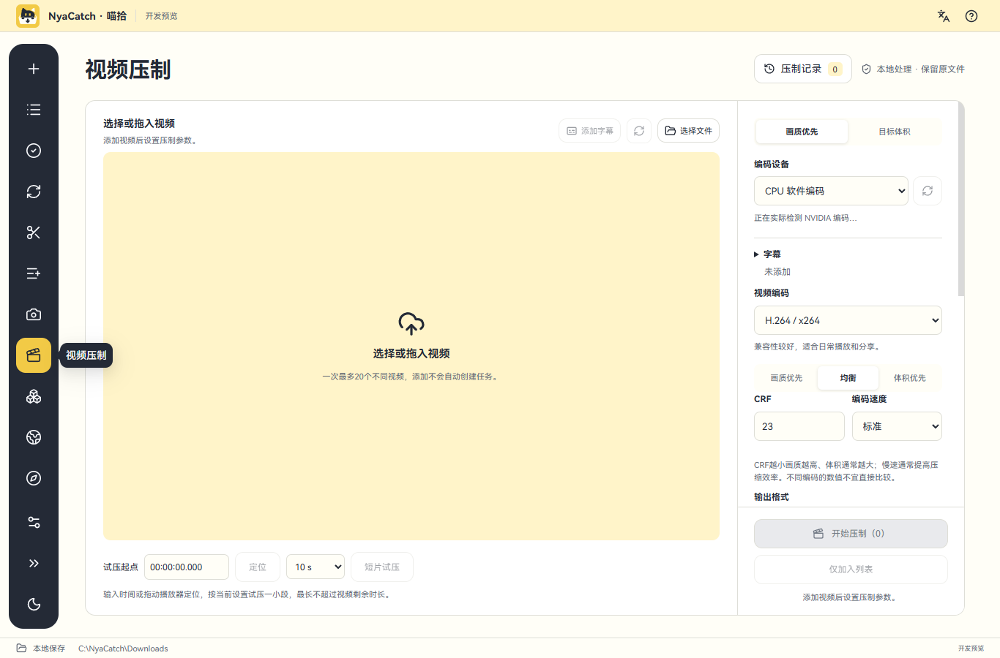

  
  <h1>NyaCatch · 喵拾</h1>
  
下载素材，整理资源，处理音视频。

  
基于 MediaGo 的 Windows 桌面工具，集成链接下载、网页素材提取与本地媒体处理。

  

    
    
    
  

  

    <a href="#下载与安装">下载与安装</a> ·
    <a href="#主要功能">主要功能</a> ·
    <a href="#界面预览">界面预览</a> ·
    <a href="#版本更新">版本更新</a> ·
    <a href="https://github.com/kuroii07/NyaCatch/issues">问题反馈</a>
  

## 下载与安装

**当前正式版为 `0.25.0`，提供 Windows x64 安装版和免安装版。**

- [下载安装版](https://github.com/kuroii07/NyaCatch/releases/download/v0.25.0/NyaCatch-0.25.0-windows-x64-setup.exe)：推荐日常使用，支持检查、下载本仓库的正式更新，安装前需确认。
- [下载免安装 ZIP](https://github.com/kuroii07/NyaCatch/releases/download/v0.25.0/NyaCatch-0.25.0-windows-x64.zip)：完整解压到可写目录后运行 `NyaCatch.exe`，数据保存在程序旁 `data/`，更新需手动下载。
- [完整发布说明与校验文件](https://github.com/kuroii07/NyaCatch/releases/tag/v0.25.0)：包含 SHA256、第三方源码资料及已知限制。

程序和安装器目前**未签名**，Windows 可能提示未知发布者。请仅从本仓库下载并核对校验值；上游 MediaGo 的安装包与喵拾不同。

目前已在 Windows 11 验证。其他 Windows 版本、macOS 与 Linux 尚未完成喵拾的运行验收。

## 主要功能

### 下载与素材提取

- **链接解析与下载**：粘贴链接或分享文本，选择实际可用的画质、音频、封面和已支持的图片资源。
- **批量解析**：最多 20 条不同链接，逐项重试和选择资源，确认后再加入队列或开始下载。
- **合集与选集**：支持已适配的 B 站 BV 多分 P、UP 主公开合集与 YouTube 公开播放列表，按集选择并分别创建任务。
- **网页素材提取**：内置浏览器、常用国内外网站入口与手动收藏；捕获资源通过默认收起的抽屉展示。
- **任务管理**：查看进度、筛选、多选、停止及重试；下载结果可继续发送到本地处理功能。

解析规则收录不代表每个网站都经过实测，也不保证平台任意内容都能下载。登录、地区、版权及平台访问限制仍然适用；部分公开帖子适配仍在实验阶段。详情见 [功能范围](docs/nyacatch/support.md)。

### 本地音视频处理

- **格式转换**：视频、音频与静态图片转换，视频尺寸按源文件限制，保持比例缩小，避免无意义放大。
- **音频提取**：直接复制首条原音轨，自动选择兼容格式；也可转换为常用音频格式。
- **片段截取**：大画面预览、标记入点与出点，一个文件最多选择 20 个片段并分别导出。
- **音视频拼接**：排序并合并 2～20 个同类文件，视频和纯音频分别提供输出设置。
- **视频截帧 / GIF**：定位导出 PNG/JPG/WebP，选择片段制作 GIF，支持常用像素尺寸与源帧率。
- **视频压制**：H.264/H.265、CPU 或受支持的 NVIDIA NVENC、CRF/CQ、目标体积两遍编码与短片试压；支持 SRT/ASS 字幕烧录和静帧预览。
- **兼容预览**：原生播放器无法读取本地素材时，显式生成低清副本，支持进度、取消、缓存复用和清理；定位与导出仍使用原文件。
- **视频封装**：MP4/MKV/MOV/TS 无损换封装，以及视频、可选音频和字幕合并。音视频直接复制，兼容检查后另存；MKV 支持 SRT/ASS 软字幕，MP4/MOV 的新增 SRT 需明确允许转换。

本地处理默认保留原文件，同名输出自动另存。不同功能的处理记录分别展示，草稿和不确定提交状态可以恢复。格式兼容性取决于内部编码，封装不会提高画质。

### 外观与使用体验

六套主题、浅色 / 深色 / 跟随系统，支持简体中文、繁体中文、English、日本語与한국어。侧栏可以收起，输入框支持鼠标右键编辑，设置与常用工作草稿保存在本机。代理与Docker未应用草稿仅保留在本次运行的内存中，退出软件即丢弃。

## 界面预览

以下为 `0.23.0-beta.1` 隔离环境实机截图，未使用个人任务或下载数据。

  
查看视频封装与视频压制

## 版本更新

- **0.25.0 正式版**：提供安装版与免安装版；安装版接入本仓库 GitHub Releases 更新，增加安装前任务检查、数据备份和旧版导入保护；收紧素材网页与桌面能力的隔离，随包附带依赖许可。[更新与使用说明](docs/nyacatch/0.25.0.md)

- **0.25.0-beta.1**：设置中心统一管理网页、兼容预览与缩略图缓存；网站登录数据独立确认清除，代理/Docker草稿跨页面保留及保存失败重试，关于页新增项目源码、反馈和发布说明。[更新说明](docs/nyacatch/0.25.0-beta.1.md)

- **0.24.0-beta.1**：新增本地兼容预览，共用于截取、截帧/GIF、压制与封装，保留原文件导出和时间轴。[更新说明](docs/nyacatch/0.24.0-beta.1.md)

- **0.23.0-beta.1**：合并封装增加 SRT/ASS 独立软字幕轨，支持视频＋音频、视频＋字幕与三文件组合。保留原字幕，不选外部音频时保留原音轨。[更新说明](docs/nyacatch/0.23.0-beta.1.md)
- **0.22.0-beta.1**：新增独立视频封装页，支持无损换封装、外部音频替换、逐轨兼容检查与独立记录。[更新说明](docs/nyacatch/0.22.0-beta.1.md)
- **0.21.0-beta.1**：视频压制增加 NVIDIA NVENC、CQ 与硬件能力检测，保留 CPU 目标体积两遍编码。[更新说明](docs/nyacatch/0.21.0-beta.1.md)

更早的功能说明见 [版本索引](docs/nyacatch/README.md)。

## 发布与更新

安装版在启动后延迟检查 **本仓库** 的 GitHub Releases；默认不自动下载，可在设置中开启。安装须明确确认，并检查活动任务、预览占用及备份结果；退出软件不会自动安装。免安装版提供手动发布页入口，开发内测版继续使用本机交付。

安装版数据位于 `%APPDATA%/NyaCatch`；从旧免安装版迁移时，在“设置 → 高级 → 目录与诊断”选择旧版 `data` 文件夹。导入前需停止任务，当前数据先备份；下载的媒体不会复制，原绝对路径继续有效。开发与构建说明见 [开发文档](docs/nyacatch/development.md)。

## 技术与致谢

喵拾基于 [MediaGo](https://github.com/mediago-dev/mediago) 的 3.5.0 源码基线继续开发，保留上游署名、许可证与基线来源。主要技术为 Electron、React、TypeScript、Go、FFmpeg 与 yt-dlp。

感谢 [FFmpeg](https://ffmpeg.org/)、[yt-dlp](https://github.com/yt-dlp/yt-dlp)、[N_m3u8DL-RE](https://github.com/nilaoda/N_m3u8DL-RE)、[BBDown](https://github.com/nilaoda/BBDown)、[aria2](https://github.com/aria2/aria2) 及其他开源依赖的开发者。它们的许可证与分发要求分别适用。

源码保留上游 [MIT LICENSE](LICENSE)。上游历史文档另有非商业用途表述，本项目不对其冲突作额外授权解释；商业使用或分发前请与上游确认，并核对所附第三方组件的许可证。请只处理你有权下载或使用的内容，遵守当地法律和平台规则。
